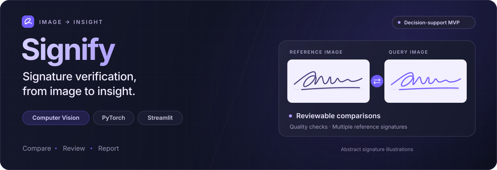
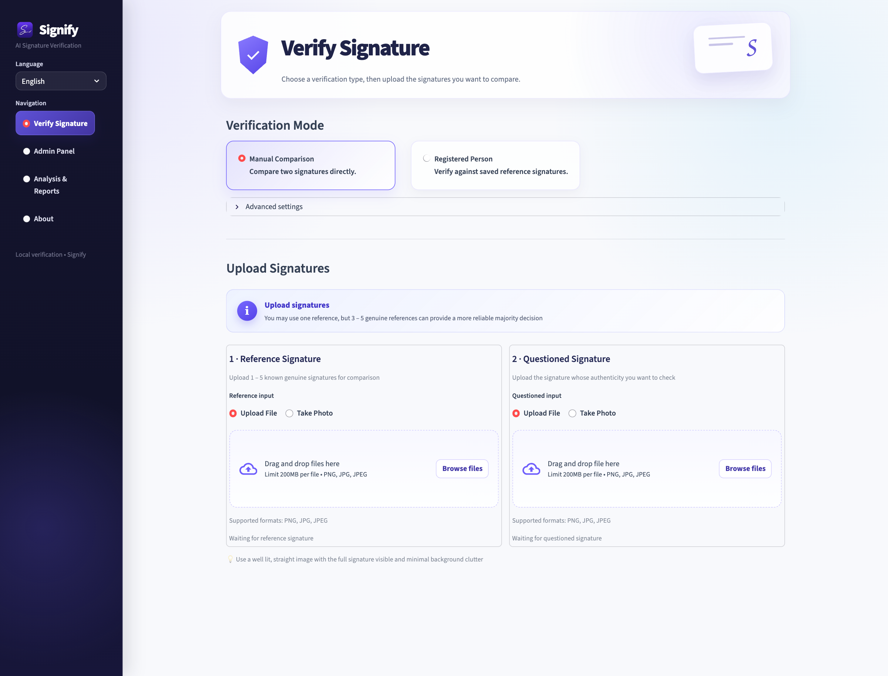
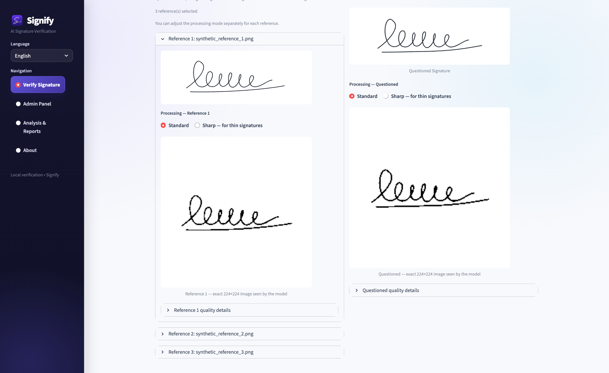
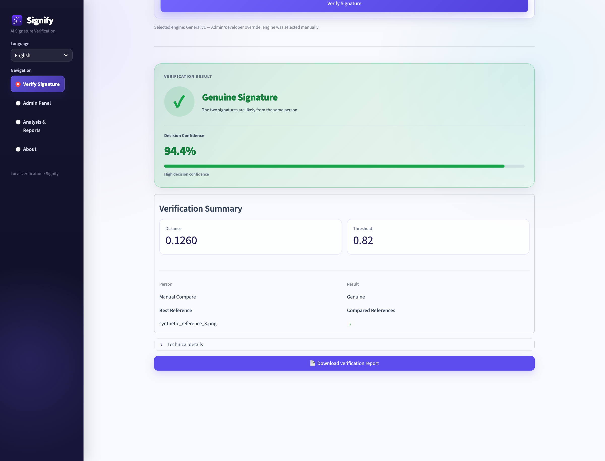
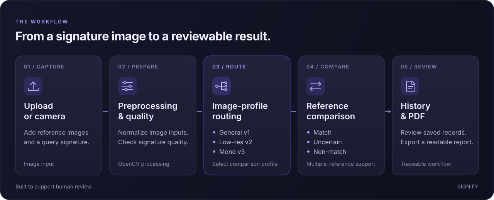

<p align="center">
  
</p>

<p align="center">
  <a href="LICENSE"></a>
  
  
  
  <a href="https://github.com/IlkeOzcendek/Signify/actions/workflows/checks.yml"></a>
</p>

<p align="center">
  <a href="#inside-the-workspace">Workspace</a> ·
  <a href="#how-it-works">Workflow</a> ·
  <a href="#run-locally">Quick start</a> ·
  <a href="docs/MODELS.md">Model setup</a> ·
  <a href="#project-structure">Source map</a>
</p>

Signify is a computer-vision prototype that compares handwritten signatures and brings the complete workflow into one application: image preparation, model selection, reference comparison, decision review and reporting.

Built with **Python, PyTorch, OpenCV and Streamlit**, it supports English and Turkish, manual comparisons and verification against registered reference signatures.

> **Public source release:** the interface runs without model checkpoints. Inference requires compatible local weights; datasets and trained checkpoints are not bundled. See [model setup](docs/MODELS.md).

## Inside the workspace



| Capability | What the application provides |
| --- | --- |
| **Two verification workflows** | Compare uploaded signatures directly, or verify against a registered person's reference collection. |
| **Image preparation** | File and camera input, cropping, standard/sharp preprocessing and previews of the exact 224 × 224 model inputs. |
| **Quality checks** | Checks for blur, insufficient ink and signatures touching image boundaries. |
| **Three verification engines** | General photographs/scans, compact low-resolution scans and high-resolution monochrome scans. |
| **Reference-aware decisions** | Multiple references, median/support-based aggregation, reference consistency checks and an explicit uncertain outcome. |
| **Review and reporting** | SQLite-backed records, analysis views, downloadable PDF reports and a bilingual interface. |

<details>
<summary><strong>See preprocessing and a verification result</strong></summary>

### Image preparation



### Comparison and reporting



These screenshots use synthetic pen strokes, not a real person's signature. The result was produced by the application with a locally available checkpoint. **Decision Confidence is the application's score for that example, not measured overall accuracy.**

</details>

## How it works



The router examines image characteristics and selects an engine. An advanced setting also allows explicit selection. Each engine's comparisons feed a decision layer that supports **match, uncertain and non-match** outcomes.

| Engine | Intended input | Implementation |
| --- | --- | --- |
| **General v1** | Photographs and standard scans | Legacy Siamese CNN; embedding-distance comparison |
| **Low-resolution scan v2** | Compact, low-resolution signatures | MobileNetV3 encoder with binary and grayscale pair heads |
| **High-resolution mono v3** | High-resolution monochrome scans | MobileNetV3 encoder with a UTSig-oriented pair head |

Model inference runs on the host computer. Person records and verification history are stored in SQLite; uploaded references use managed local file storage.

## Run locally

Use Python 3.9 or newer; Python 3.11 is used by the repository checks.

```bash
git clone https://github.com/IlkeOzcendek/Signify.git
cd Signify
python3 -m venv .venv
source .venv/bin/activate
python -m pip install --upgrade pip
python -m pip install -r requirements.txt
python -m alembic upgrade head
python -m streamlit run app.py --server.address 127.0.0.1
```

On Windows, activate the environment with `.venv\Scripts\Activate.ps1`, then run the same `python -m ...` commands.

Open **http://localhost:8501**. The interface starts in English; use the sidebar to switch languages. On macOS/Linux, `bash run.sh` is also available after installing the dependencies.

### Try the workflow

1. Open **Verify Signature → Manual Comparison**.
2. Upload the reference images and questioned image from [`examples/synthetic`](examples/synthetic).
3. Inspect the source images, preprocessing options and model-input previews.
4. To produce a comparison result, configure compatible checkpoints. The synthetic example can use **Advanced settings → General v1**.

The example images demonstrate the interface and input pipeline. They are not a benchmark dataset.

### Model setup

Place compatible checkpoints under `models/` using the filenames in [the model guide](docs/MODELS.md). No public checkpoint download is bundled with this release. The application shows setup guidance if the selected engine's files are missing.

## Project structure

```text
app.py                  Streamlit entry point
app_pages/              Verification, administration, analysis and about views
verify*.py              General, low-resolution and monochrome inference
preprocess.py           Image cleaning and standardization
src/models/             Siamese encoders, comparison heads and loss functions
src/preprocessing/      Dataset loading and grayscale preprocessing
utils/                  Quality checks, decisions, reports, routing and UI
db/                     SQLAlchemy models, repositories and managed storage
alembic/                Database migrations
scripts/                Training, calibration and evaluation experiments
examples/synthetic/     Artificial inputs for interface exploration
tests/                  Checks that do not require trained weights or datasets
docs/                   Model setup, screenshots and vector diagrams
```

## Development and evaluation

```bash
python -m unittest discover -s tests -v
```

Training and evaluation scripts are included for research use. Their datasets, splits and model architectures must be configured explicitly. In particular, **the newer model trained by `train.py` is not a drop-in replacement for the application's default legacy checkpoint**. See [training and checkpoint compatibility](docs/MODELS.md#training-and-checkpoint-compatibility).

`test.py` is a dataset-dependent model evaluation script; the `tests/` directory contains the separate automated checks.

## Scope

Signify is a **decision-support MVP**, not a certified forensic or identity-verification system. Thresholds and score mappings are prototype settings; performance depends on the data and capture conditions. Uncertain cases require additional evidence and review.

## License and credits

Original project code and included project assets are available under the [MIT License](LICENSE). Third-party libraries, datasets and pretrained weights retain their own terms; this repository does not redistribute the signature datasets or trained checkpoints. See [third-party notes](docs/THIRD_PARTY.md).

Created by **[İlke Özçendek](https://github.com/IlkeOzcendek)** · [LinkedIn](https://www.linkedin.com/in/ilkeozcendek/)
